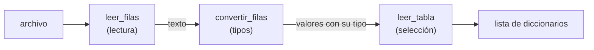

# Lector de datos tabulares

Trabajo práctico grupal de Programación II. Facultad de Ciencias Económicas y Estadística, UNR, 2026.

 

Módulo de Python que lee tablas almacenadas en archivos de texto plano (CSV y formatos similares)
y las devuelve como una lista de diccionarios. El análisis del texto y la conversión de tipos están
implementados sin el módulo `csv` ni los lectores de pandas.

| Integrante | Parte | Carpeta |
|---|---|---|
| Mengarelli, Luca Franco | Lectura y separación de campos | `lectura` |
| Capella, Lucas | Conversión de tipos | `tipos_lucas` |
| Morello, Nino Julián | Selección de filas y columnas | `seleccion_nino` |

## Funcionamiento

La lectura se resuelve en tres etapas. Cada una recibe el resultado de la anterior.



Cada fila conserva su número de línea en el archivo, de modo que todo error indica dónde ocurrió.

## Lectura

- **Separador.** Por defecto es la coma. Puede ser cualquier texto (`;`, `\t`, `||`) o `None`, que
  toma como separador cualquier cantidad de espacios o tabulaciones.
- **Comillas.** Un campo entre comillas no se divide aunque contenga el separador
  (`"Santa Clara, California"`) y puede ocupar varias líneas. Dentro de él, `""` representa una comilla.
  Una comilla en medio de un campo (`ab"c`) se toma como texto.
- **Espacios.** Se eliminan al principio y al final de cada campo, salvo dentro de las comillas.
- **Encabezado.** La primera fila da nombre a las columnas. Un nombre vacío se reemplaza por
  `columna_N` y uno repetido por `nombre_2`, `nombre_3`, con un aviso (`EncabezadoWarning`).
  Con `encabezado=False` todas las columnas se llaman `columna_1`, `columna_2`, etc.
- **Líneas vacías.** Se omiten. Una línea con solo separadores (`,,`) no se considera vacía: produce campos vacíos.
- **Archivo con solo encabezado.** Devuelve las columnas y ninguna fila.
- **Codificación.** Se lee en UTF-8, ignorando el carácter inicial que agrega Excel. Si el archivo
  no es UTF-8, se lee en cp1252, la codificación de Excel en Windows.
- **Número de línea.** Corresponde a la línea del archivo donde comienza la fila.

## Errores

| Situación | Resultado |
|---|---|
| Archivo vacío | `ArchivoVacioError` |
| Fila con distinta cantidad de campos que el encabezado | `CantidadCamposError`, con la línea |
| Comilla que no se cierra | `ComillasError`, con la línea |
| Separador vacío (`""`) | `ValueError` |

## Visualización

`demo.py` muestra cada resultado de dos formas: como lista de diccionarios, que es lo que devuelve
el lector, y como `DataFrame` de pandas. Se muestran ambas porque pandas modifica la representación
de algunos valores; por ejemplo, un `None` en una columna de texto aparece como `NaN`.

```
pip install -r requirements.txt
python demo.py
```

pandas se usa solo en la demostración, nunca dentro del lector.

## Pruebas

Desde la carpeta del proyecto:

```
python -m lectura.pruebas
```

<!--
pendiente, cada uno agrega su seccion cuando termine:
- uso (nino): ejemplo de leer_tabla y para que sirve cada parametro
- tipos (lucas): como se elige el tipo de cada columna (10, 20, 30.5 / numeros y texto / columna vacia),
  que textos son booleanos, como quedan los nulos, tipo elegido por el usuario (00123) y que pasa si no se puede convertir
- seleccion (nino): numeracion de filas, si el rango incluye los extremos, orden entre rango, filtro y n_filas,
  filtrar por una columna que no se muestra
- organizacion (todos): que otras opciones pensamos y por que elegimos esta
- errores y pruebas: agregar lo de tipos y seleccion
-->
